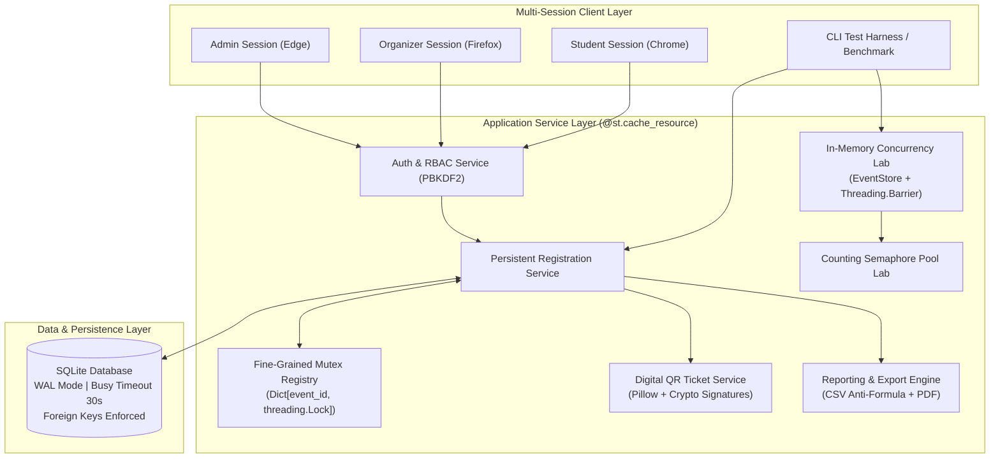
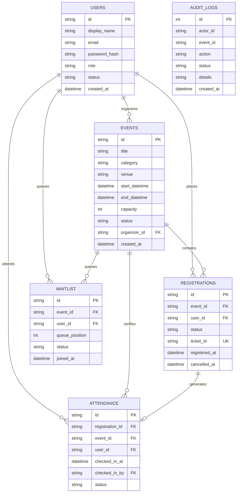
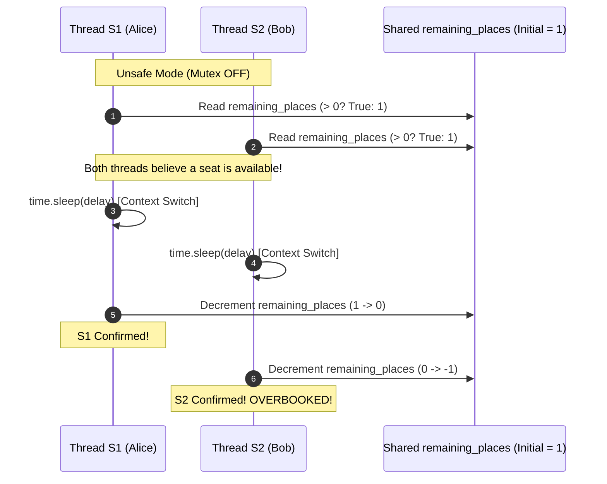
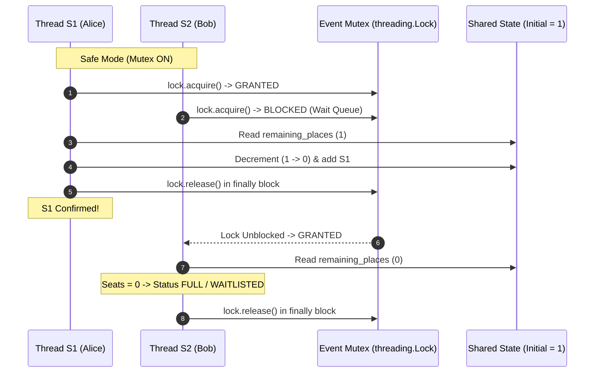

# 🔒 Event & Workshop Registration System — Mutex Synchronization Monitor
### Operating Systems & Computer Networks Academic Capstone (20-Mark Evaluation)
**Architecture:** Shared SQLite (WAL Mode) + Fine-Grained Per-Event Mutex (`threading.Lock`) + Counting Semaphore Lab

---

## 📌 1. Problem Statement
Several users attempt to register for a workshop at the same time when only one or two places remain. Without synchronization, concurrent threads can read the same remaining-capacity value and all be confirmed, causing overbooking and an incorrect capacity count. The application protects the capacity check-and-update (the **critical section**) with a **mutex lock** (`threading.Lock`) so that only one registration thread updates the shared data at a time, the remaining capacity is always correct, and duplicate registrations are prevented.

---

## 🎯 2. Project Objectives
1. **Operating Systems Concurrency Demonstration:** Reproduce non-deterministic race conditions under controlled multi-thread contention, visualize thread scheduling queues, and prove atomicity under mutual exclusion.
2. **Fine-Grained Concurrency:** Advance beyond global lock bottlenecks to event-specific mutexes (`Dict[str, threading.Lock]`), ensuring operations on independent workshops execute in parallel without contention.
3. **Persistent ACID Correctness:** Couple in-memory synchronization with an authoritative SQLite database using Write-Ahead Logging (WAL) and atomic transactions to prevent phantom reads and ensure reboot survival.
4. **FIFO Waitlist with Automatic Promotion:** Maintain fair queueing when workshops reach capacity, automatically promoting the earliest waitlisted student upon cancellation.
5. **Tamper-Evident Digital Passports:** Generate local cryptographic QR ticket passes for confirmed attendees with server-side check-in verification.
6. **Enterprise Security & Reliability:** Enforce Role-Based Access Control (Student, Organizer, Administrator), complete HTML escaping against Stored XSS, and CSV formula injection neutralization.
7. **Premium SaaS UI/UX Architecture:** Clean dark navy / charcoal design system (`ui_theme.py`), 4 dynamic KPI metrics, responsive upcoming events grid, Plotly enrollment charts, and real-time audit activity feed.

---

## 🏛️ 3. System Architecture



---

## 🗄️ 4. Database Design (Entity-Relationship Diagram)



---

## ⚙️ 5. Thread Synchronization & Concurrency Mechanics

### The Check-Then-Act Race Condition
In an unsynchronized system, checking availability and committing decrement are distinct operations separated in time:

```python
# VULNERABLE NON-ATOMIC EXECUTION WINDOW
if remaining_places > 0:            # 1. READ (Thread A & B both see 1)
    time.sleep(delay)               # 2. CONTEXT SWITCH (Interleaving)
    remaining_places -= 1           # 3. WRITE (Both decrement to 0 and -1)
    registrations.add(user)         # 4. OVERBOOKING CORRUPTION!
```

### Race Interleaving Sequence Diagram



### Synchronized Execution Sequence Diagram



---

## ⚖️ 6. Mutex vs Semaphore vs Database Transaction

| Dimension | Mutex (`threading.Lock`) | Counting Semaphore (`threading.Semaphore`) | Database Transaction (SQLite ACID) |
| :--- | :--- | :--- | :--- |
| **Mechanism** | Strict mutual exclusion locking | Resource permit counter | Write-Ahead Log (WAL) commit serialization |
| **Capacity** | Exactly 1 thread in critical section | Up to $N$ concurrent permit holders | Serialized atomic transaction block |
| **Ownership** | Thread that acquires **must** release | Any thread can signal / release | Connection boundary |
| **Ordering** | OS scheduler queue | OS scheduler queue | FIFO transaction lock queuing |
| **Crash Safety**| Enforced via Python `try...finally` | Enforced via Python `try...finally` | Automatic rollback on error |
| **Scope** | In-process shared memory | In-process resource pools | Cross-process, disk-persistent state |

---

## 🛡️ 7. System Invariants & Mathematical Proofs

1. **Non-Negativity Invariant:**  
   $$\text{remaining\_places} \ge 0 \quad \forall t \ge 0$$
2. **Capacity Conservation Invariant:**  
   $$\text{capacity} - \text{remaining\_places} = |\text{registrations}_{\text{active}}|$$
3. **No-Duplicate Invariant:**  
   $$|\text{registrations}(E_i)| = |\{u \mid u \in \text{registrations}(E_i)\}|$$
4. **FIFO Fairness Invariant:**  
   $$\text{If } u_a \text{ joined waitlist before } u_b \implies \text{promotion\_time}(u_a) \le \text{promotion\_time}(u_b)$$

---

## 🚀 8. Quickstart & Installation (Windows PowerShell)

### Prerequisites
* Python 3.10 or higher
* Windows PowerShell

### Step 1: Clone & Enter Directory
```powershell
cd "c:\Users\Darsh\OneDrive\Desktop\PS PROJECT-2 (OS & CN)"
```

### Step 2: Install Verified Dependencies
```powershell
pip install -r requirements.txt
```

### Step 3: Seed Demonstration Events (Optional / Auto-Initialized)
```powershell
python seed_events.py
```
> Populates 20 realistic workshops across computer science & professional disciplines, safely preventing duplicates if already seeded.

### Step 4: Run the 15-Test Automated Verification Suite (CLI)
```powershell
python test_cases.py
```
> **Expected Output:** `RESULT: ALL 15/15 TESTS PASSED SUCCESSFULLY! (Full Verification)`

### Step 5: Launch the Streamlit Dashboard
```powershell
streamlit run app.py
```
*Your browser will automatically open to `http://localhost:8501`.*

---

## 🎬 9. 5–7 Minute Viva Voce & Presentation Script

| Step | Time | Navigation Tab | Action & Speaking Points |
| :---: | :---: | :--- | :--- |
| **1** | 0:00–0:45 | **🏠 Dashboard** | Introduce the problem statement. Highlight live SaaS header with date indicator and the 4 dynamic KPI cards (Total Events, Total Registrations, Available Seats, Registration Rate). Show the responsive Upcoming Events cards, Plotly enrollment charts, and live Recent Activity feed. |
| **2** | 0:45–2:15 | **⚡ Concurrency Simulator** | Click sidebar preset **🎬 Lab (1 Seat)**. Click **⚡ Run Side-by-Side Comparison**. Show the Left Column (Unsafe): Red **OVERBOOKED** banner, 3 confirmed for 1 seat, remaining drops to -2. Contrast with Right Column (Safe): Green **CONSISTENT** banner, exactly 1 confirmed, remaining 0. |
| **3** | 2:15–3:15 | **🧵 Thread Timeline** | Show the **Plotly Gantt Chart**. Point out amber wait bars (`lock.acquire()`) followed by serialized green critical sections in Safe mode vs overlapping red blocks in Unsafe mode. |
| **4** | 3:15–4:00 | **🔍 Registration Portal** & **🎫 My Registrations** | Switch to Student role (`student_alice`). Register for a workshop. Show the generated **Digital QR Pass Badge Card**. Download the PNG badge. |
| **5** | 4:00–4:45 | **🎟️ Attendance Check-In** | Switch to Organizer (`prof_turner`). Enter the ticket ID from Step 4. Click **Verify & Check In**. Show the success message and timestamped attendance roster. Enter the same ticket again to prove **Duplicate Attendance Rejection**. |
| **6** | 4:45–5:30 | **📋 Attendee Rosters** | Show the roster table. Click **Export Sanitized CSV** (highlight formula injection protection). Click **Generate Official Printable PDF Report** to download the high-res PDF. |
| **7** | 5:30–6:00 | **🧪 Test Center** | Click **▶️ Run Complete 15-Test QA Suite**. Display the **15/15 PASS** scorecard covering OS synchronization, fine-grained locking, persistence, waitlist promotion, catalog seeding idempotency, and security. |

---

## 💬 10. Key Viva Questions & Model Answers

### Q1: Why use a Mutex Lock instead of a Counting Semaphore for seat registration?
> **Answer:** *"A counting semaphore tracks available permits, but does not enforce mutual exclusion across non-atomic check-then-act operations. Registration requires checking duplicates, verifying capacity, decrementing remaining seats, and inserting user records. A semaphore with capacity $N$ would allow $N$ threads into that composite section simultaneously, leading to race conditions on user sets. A Mutex (`threading.Lock`) strictly guarantees that only one thread enters the critical section at any instant."*

### Q2: What prevents deadlocks in your locking architecture?
> **Answer:** *"Deadlock requires Coffman's four conditions: Mutual Exclusion, Hold and Wait, No Preemption, and Circular Wait. In our design, registration threads acquire only **one** lock per operation (either the global mutex or the event-specific lock) and release it immediately in a `try...finally` block. Because threads never attempt to hold one lock while requesting another, Circular Wait and Hold-and-Wait are structurally impossible."*

### Q3: Python has a Global Interpreter Lock (GIL). Why did you still need explicit synchronization?
> **Answer:** *"The GIL only ensures that one thread executes Python bytecode at a time; it does not provide application-level atomicity. High-level statements like `remaining -= 1` compile to multiple bytecode instructions (LOAD, SUBTRACT, STORE). Furthermore, I/O operations and sleep calls release the GIL. The simulated teaching delay explicitly exposes the OS context-switching window, proving that user-space data structures corrupt without explicit synchronization."*

### Q4: What is the advantage of Fine-Grained Per-Event Locking over a Global Lock?
> **Answer:** *"A global mutex creates an artificial concurrency bottleneck across unrelated resources: a student registering for 'Python Workshop' (E1) blocks students registering for 'AI Seminar' (E2). Fine-grained per-event locking assigns a dedicated mutex to each event ID (`Dict[event_id, threading.Lock]`), allowing concurrent registrations across different events to execute in parallel while keeping operations on the same event strictly synchronized."*

### Q5: How does your system prevent CSV Formula Injection?
> **Answer:** *"Spreadsheet applications (Excel, LibreOffice) automatically execute cells beginning with `=`, `+`, `-`, `@`, `\t`, or `\r` as dynamic formulas or DDE macros. In `report_service.py`, our sanitizer inspects every string cell; if a dangerous leading character is detected, it prepends a single quotation mark (`'`), forcing spreadsheet software to treat the cell strictly as plain text."*

---

## 📊 11. Automated Test Suite Summary (`python test_cases.py`)

| Test ID | Test Scenario | Category | Result |
| :---: | :--- | :--- | :---: |
| **T1** | Sequential Booking (1 seat, 2 users) | OS Synchronization | **PASS** |
| **T2** | Concurrent Unsafe Contention (1 seat, 3 users) | Race Condition Exposure | **PASS** |
| **T3** | Concurrent Safe Mutex (1 seat, 3 users) | Mutual Exclusion | **PASS** |
| **T4** | 10 Users Competing for 2 Seats | Boundary Contention | **PASS** |
| **T5** | Concurrent Duplicate Registration Attempt | Critical Section Deduplication | **PASS** |
| **T6** | Cancel and Re-Register Workflow | Seat Recovery Invariant | **PASS** |
| **T7** | High-Contention Stress (50 Threads, 5 Seats) | Scalability & Non-Negativity | **PASS** |
| **T8** | Exception Safety (`try...finally` Release) | Deadlock Resilience | **PASS** |
| **T9** | Fine-Grained Per-Event Locking Concurrency | Advanced OS Synchronization | **PASS** |
| **T10** | SQLite Persistence Across Reboot Cycles | Storage Layer Durability | **PASS** |
| **T11** | FIFO Waitlist Atomic Promotion | Queue Theory & Permitting | **PASS** |
| **T12** | QR Ticket Verification & Duplicate Check-In | Security & Attendance | **PASS** |
| **T13** | Stored XSS & CSV Formula Injection Sanitization | Security & Defensive Design | **PASS** |
| **T14** | Role-Based Access Control (RBAC) Boundaries | Authorization Enforcement | **PASS** |
| **T15** | Event Catalog Seeding & Idempotent Non-Duplication | Data Integrity & Seeding | **PASS** |
| **TOTAL**| **15 Executed Test Cases** | **All Invariants Verified** | **15 / 15 PASS** |

---

## 🔮 12. Known Limitations & Future Scope
1. **In-Process Locking vs Distributed Clusters:** Python `threading.Lock` coordinates threads within a single operating system process. To scale horizontally across multiple container replicas or server nodes, in-process locks would be replaced by distributed locks using Redis (`Redlock`) or PostgreSQL row-level locks (`SELECT ... FOR UPDATE`).
2. **Camera-Based Web Scanning:** Physical mobile camera barcode scanning is currently implemented via ticket token verification. Integrating WebRTC camera capture components in Streamlit would enable physical barcode hardware scanning.
